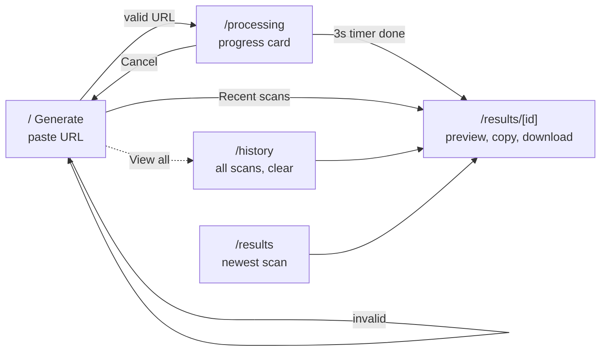
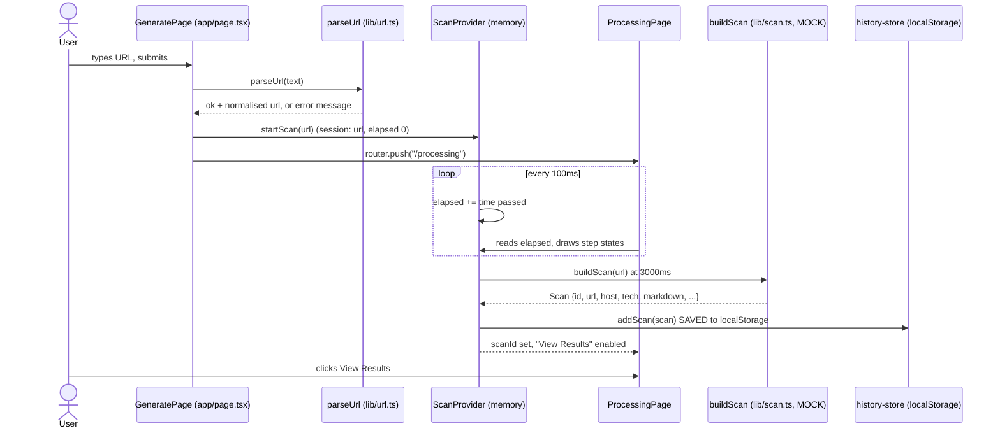
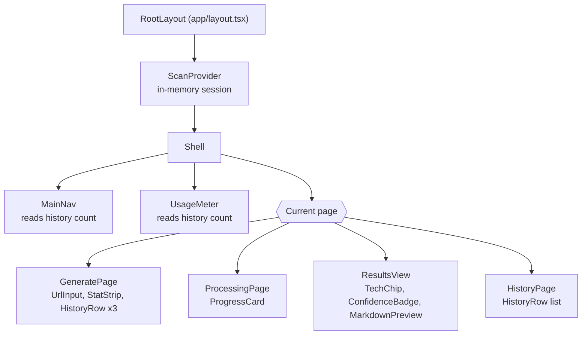
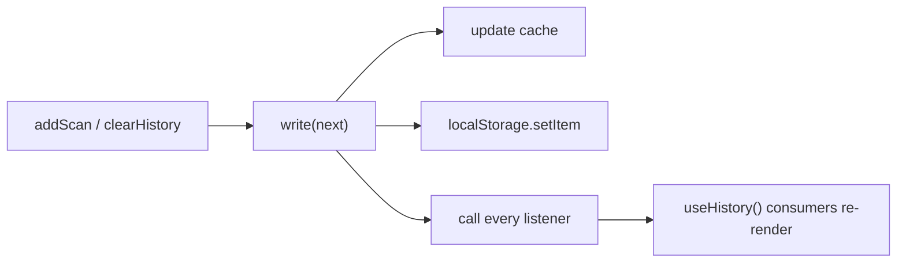
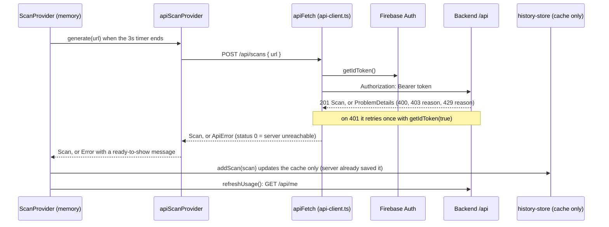
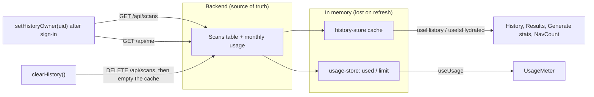

# Project MD: how the app works

Everything runs in the browser today. There is no backend, and the scan is a mock
(`buildScan` in `frontend/lib/scan.ts`). Diagrams are Mermaid; open this file in a Markdown
preview with Mermaid support (VS Code: "Markdown Preview Mermaid Support" extension, or GitHub).

## 1. User flow (pages)



## 2. What happens when you press "Generate .MD"



## 3. Component tree



## 4. Where data lives

```mermaid
flowchart LR
  subgraph Memory["In memory (lost on refresh)"]
    SES["ScanProvider session<br/>url, elapsed, scanId"]
    UI["Page UI state<br/>typed URL, error, tab, format,<br/>copy status, confirm-clear"]
    CACHE["history-store cache"]
  end
  subgraph Disk["Browser localStorage (persists)"]
    LS["key: projectmd.history<br/>JSON array of Scan"]
  end
  SES -->|buildScan result| ADD["addScan()"]
  ADD --> CACHE
  ADD --> LS
  LS -->|read() once per page load| CACHE
  CACHE -->|useHistory()| VIEWS["Generate stats, History, Results,<br/>NavCount, UsageMeter"]
```

Saved `Scan` object (`lib/types.ts`): `id`, `url`, `host`, `createdAt`, `durationMs`,
`confidence`, `pages`, `tech[]` (name, highlighted), `markdown`.

## 5. History store (subscribe / notify)



## 6. Replacing the mock with the backend (`NEXT_PUBLIC_SCAN_PROVIDER=api`)

The switch is one variable, read once at build/dev-server start. Unset or `static` is everything
described above (mock scan, history in localStorage, no network). `api` talks to the ASP.NET Core
backend at `NEXT_PUBLIC_API_URL` (default `http://localhost:5080`) with the Firebase ID token as a
Bearer header. The backend re-checks the token, role, `email_verified` and the monthly quota; the
frontend checks are only for a friendlier UI. The backend's scan generator is still a mock; the
real fetch/render/fingerprint/LLM pipeline is a later backend job, and no API key ever reaches the
frontend.





Notes:
- `useIsHydrated()` stays false while the first list is loading, so pages never flash "No scans yet".
  If loading fails, `useHistoryStatus().error` holds the message and History offers a Retry button.
- Errors are mapped once in `apiErrorMessage` (`app/functions/data/api-client.ts`): 403 `unverified`,
  403 `role`, 429 `quota`, other 429, 400 (the server's own text) and "Can't reach the server".
- The first `GET /api/me` after sign-in also makes the backend create the user's row.
