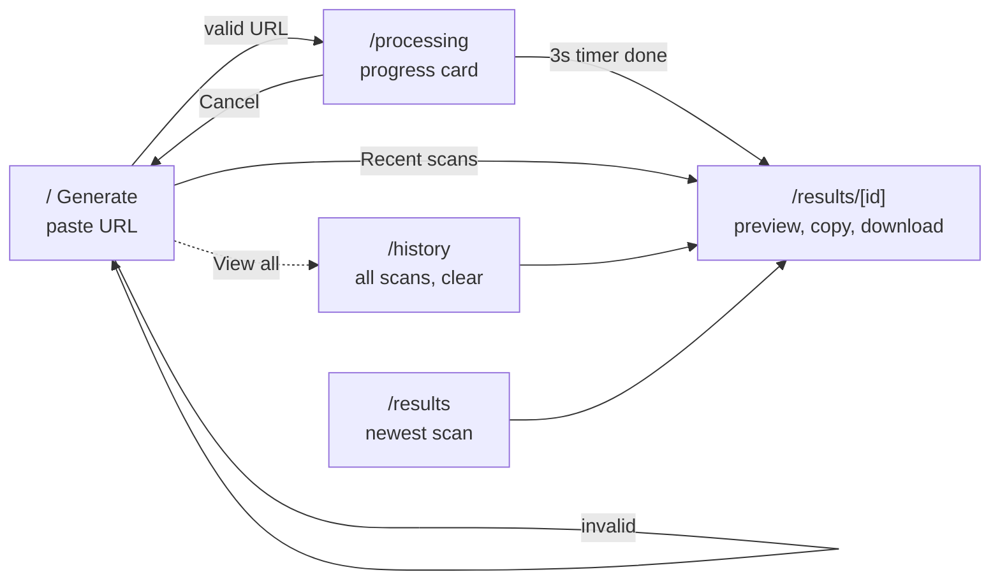
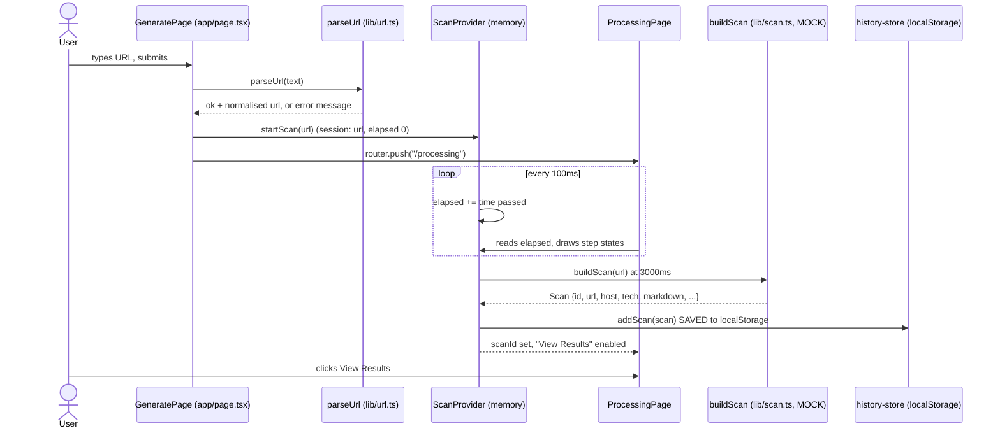
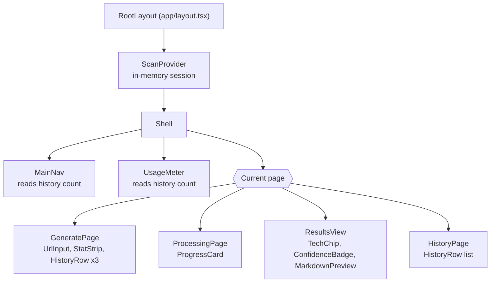
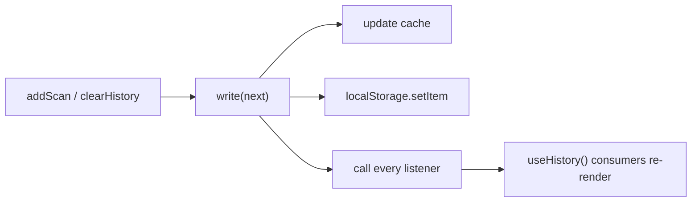
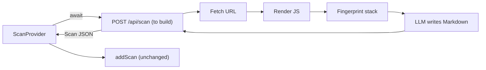

# Project MD: how the app works

Everything runs in the browser today. There is no backend, and the scan is a mock
(`buildScan` in `frontend/lib/scan.ts`). Diagrams are Mermaid; open this file in a Markdown
preview with Mermaid support (VS Code: "Markdown Preview Mermaid Support" extension, or GitHub).

## 1. User flow (pages)



## 2. What happens when you press "Generate .MD"



## 3. Component tree



## 4. Where data lives

```mermaid
flowchart LR
  subgraph Memory["In memory (lost on refresh)"]
    SES["ScanProvider session<br/>url, elapsed, scanId"]
    UI["Page UI state<br/>typed URL, error, tab, format,<br/>copy status, confirm-clear"]
    CACHE["history-store cache"]
  end
  subgraph Disk["Browser localStorage (persists)"]
    LS["key: projectmd.history<br/>JSON array of Scan"]
  end
  SES -->|buildScan result| ADD["addScan()"]
  ADD --> CACHE
  ADD --> LS
  LS -->|read() once per page load| CACHE
  CACHE -->|useHistory()| VIEWS["Generate stats, History, Results,<br/>NavCount, UsageMeter"]
```

Saved `Scan` object (`lib/types.ts`): `id`, `url`, `host`, `createdAt`, `durationMs`,
`confidence`, `pages`, `tech[]` (name, highlighted), `markdown`.

## 5. History store (subscribe / notify)



## 6. Planned: replacing the mock with a real backend


