# How Project MD works, end to end

> Snapshot of the `Testing` branch, 2026-10-26. For a picture-first version open
> [visual-guide.html](visual-guide.html) in a browser. For all 82 steps with the exact file and line of code
> behind each one, open [step-by-step.html](step-by-step.html). The diagrams below are Mermaid: in VS Code install
> "Markdown Preview Mermaid Support" and press `Ctrl+Shift+V`; GitHub renders them as is.
>
> Heads up: [docs/ARCHITECTURE.md](../ARCHITECTURE.md) is out of date (it still says the backend generator is a
> mock). This file is the current picture.

---

## 0. The 30-second version

You paste a URL. The **Next.js frontend** sends it with your **Firebase sign-in token** to the **ASP.NET Core
backend**. The backend checks who you are and what your **role** allows, then opens the page in a real
**headless Chrome (Playwright)**, measures everything it can (HTML, tech, CSS, colours, fonts, API calls,
components, animations, screenshots), and asks **Groq** up to three times to write the human parts. It
builds a Markdown document plus structured JSON, saves both in **PostgreSQL**, and sends the result back. The
frontend shows it on the Results page in five tabs.

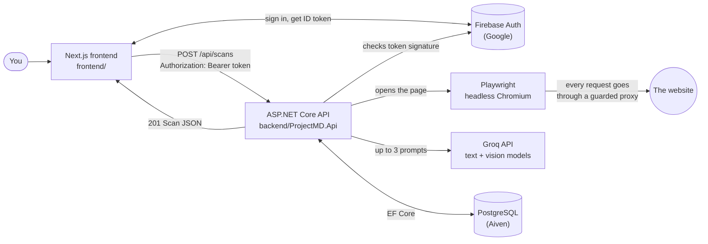

---

## 1. Map of the code

| Area | Folder | What lives there |
| --- | --- | --- |
| Pages (routes) | [frontend/app/](../../frontend/app/) | `(auth)/` login, signup, reset, verify. `(workspace)/` Generate `/`, `/processing`, `/results/[id]`, `/history`, `/admin/users`. |
| Frontend logic | [frontend/app/functions/](../../frontend/app/functions/) | `auth/` (Firebase sign-in, guards), `rbac/` (roles and permissions), `data/` (API client, stores, static mock), `firebase/` (SDK setup). |
| UI components | [frontend/components/](../../frontend/components/) | `results/` (the tabs), `shell/` (sidebar, nav, usage meter), `auth/` (forms), `admin/`, `ui/` (buttons, URL bar, tiles). |
| Frontend helpers | [frontend/lib/](../../frontend/lib/) | `url.ts` (URL check), `scan.ts` (progress steps), `history-store.ts`, `design-export.ts`, `types.ts`. |
| API entry | [backend/ProjectMD.Api/Program.cs](../../backend/ProjectMD.Api/Program.cs) | Middleware order, CORS, Swagger, DB registration. |
| Endpoints | [backend/ProjectMD.Api/Controllers/](../../backend/ProjectMD.Api/Controllers/) | `ScansController`, `MeController`, `AdminController`, `HealthController`. |
| Auth + RBAC | [backend/ProjectMD.Api/Auth/](../../backend/ProjectMD.Api/Auth/) | Firebase JWT check, DB role lookup, permission policies. |
| Database | [backend/ProjectMD.Api/Data/](../../backend/ProjectMD.Api/Data/), [Models/](../../backend/ProjectMD.Api/Models/) | `AppDbContext`, migrations, tables. |
| Scraping | [Services/Extraction/](../../backend/ProjectMD.Api/Services/Extraction/) | Playwright fetcher, request guard, HTML reducer, design/component/visual capture, API recorder. |
| AI | [Services/Ai/](../../backend/ProjectMD.Api/Services/Ai/) | Groq client, the three prompt builders, cache, budget guard, sanitisers. |
| Assembly | [Services/Pipeline/](../../backend/ProjectMD.Api/Services/Pipeline/) | `PipelineScanGenerator` (the conductor), Markdown builders, animation report. |
| Settings | [appsettings.json](../../backend/ProjectMD.Api/appsettings.json) + `backend/.env` | `Scanner`, `Motion`, `Ai`, `Usage`, `Auth`, `Firebase`. |

---

## 2. Where your input goes (the full journey)

The input box is `UrlInput` ([components/ui/url-input.tsx](../../frontend/components/ui/url-input.tsx)) on the
Generate page ([app/(workspace)/page.tsx](../../frontend/app/(workspace)/page.tsx)).

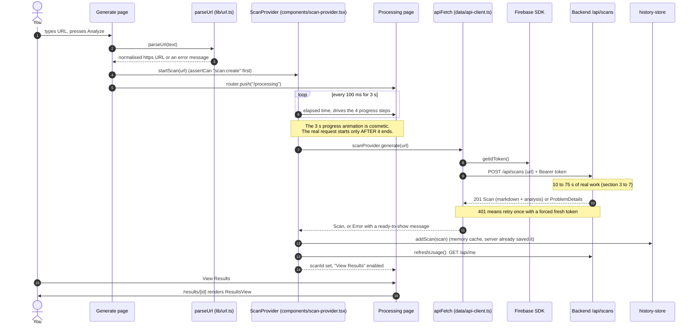

Things worth knowing:

- `parseUrl` in the browser and `UrlValidator` on the server **both** check the URL. The browser check is only
  for a quick message; the server check is the real one.
- The progress steps in [lib/scan.ts](../../frontend/lib/scan.ts) (300 + 600 + 900 + 1200 ms) are a fixed
  animation. While the backend works, the last step stays "current".
- `NEXT_PUBLIC_SCAN_PROVIDER` picks the data source ([data/mode.ts](../../frontend/app/functions/data/mode.ts)):
  `api` = the real backend, anything else = a mock scan made in the browser and stored in `localStorage`.

---

## 3. Inside the backend: what a request passes through

Order is set in [Program.cs](../../backend/ProjectMD.Api/Program.cs) and it matters.

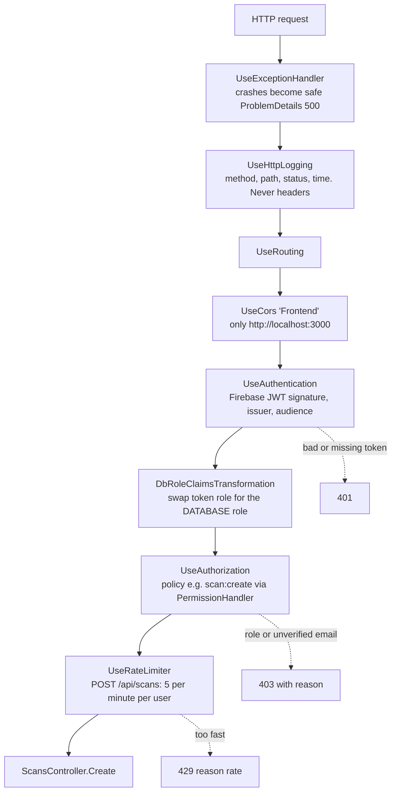

`ScansController.Create` ([ScansController.cs](../../backend/ProjectMD.Api/Controllers/ScansController.cs)) then:

1. Validates the URL (`UrlValidator`): http/https, public host, no private or internal addresses. 400 `url` otherwise.
2. Finds or creates your `AppUsers` row (`UserSync`).
3. Cheap quota check: `Usage:MonthlyLimit` (10). 429 `quota` when used up.
4. `IScanGenerator.GenerateAsync(url)`, which is the pipeline in section 4.
5. Refuses a document over 1 MB.
6. `ScanRecorder.TryRecordAsync`: re-checks the quota inside a transaction and saves the `Scans` row.
7. Returns 201 with the `ScanDto` (id, url, host, tech, confidence, markdown, analysis).

---

## 4. The pipeline (the conductor)

`Scanner:Mode` picks the generator ([ScanServiceCollectionExtensions.cs](../../backend/ProjectMD.Api/Services/ScanServiceCollectionExtensions.cs)):

| Mode | Generator | Playwright | Groq |
| --- | --- | --- | --- |
| `static` (default in `appsettings.json`) | `StaticScanGenerator`, a **mock** | no | no |
| `extract` | `PipelineScanGenerator` | yes | no |
| `ai` | `PipelineScanGenerator` | yes | yes, if `Ai__ApiKey` is set |

So real scans need `Scanner__Mode=ai` (or `extract`) in `backend/.env`.

[PipelineScanGenerator.GenerateAsync](../../backend/ProjectMD.Api/Services/Pipeline/PipelineScanGenerator.cs):

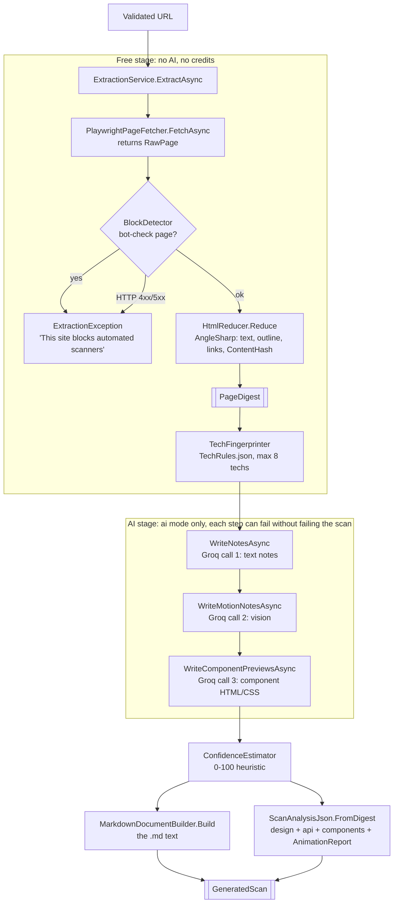

The Markdown has these sections: `## Overview`, `## Architecture`, `## Tech stack`, `## API endpoints`,
`## Design system`, `## Design breakdown`, `## Motion and animation`, `## Page structure`, `## Developer tips`.
**Facts** (tech, endpoints, colours, outline) are always written by code. Groq only writes the **prose**.
If Groq is off, over budget or fails, you still get the document, just with less prose.

---

## 5. Where Playwright comes in

Playwright is **only in the backend** (`Microsoft.Playwright` 1.63 for .NET,
[PlaywrightPageFetcher.cs](../../backend/ProjectMD.Api/Services/Extraction/PlaywrightPageFetcher.cs)).
One headless Chromium is shared by the app; each scan gets a fresh, throw-away browser context.

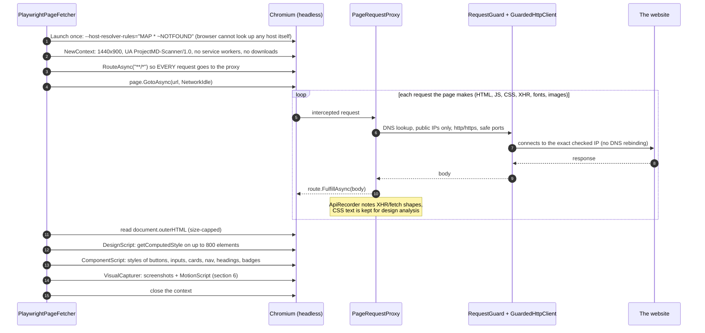

Why the proxy: Playwright's own interception misses redirect hops, so a public URL redirecting to
`169.254.169.254` (cloud metadata) could slip through. With name lookup switched off in the browser and every
request fetched by our guarded client, the browser can only see what we allow (SSRF protection).

> `frontend/lib/scrape.ts` and `test-scrape.ts` also import `playwright`, but nothing in the app uses them,
> `playwright` is not in `frontend/package.json`, and they have no private-address guard. They look like an old
> experiment; the real scraper is the backend one.

---

## 6. Screenshots: how they are taken and how they are read

[VisualCapturer.cs](../../backend/ProjectMD.Api/Services/Extraction/Visual/VisualCapturer.cs), with numbers from
the `Motion` section of [appsettings.json](../../backend/ProjectMD.Api/appsettings.json):

1. **Evidence on load**: run [MotionScript](../../backend/ProjectMD.Api/Services/Extraction/Visual/MotionScript.cs) in the page.
2. Mouse to the centre of the window, **screenshot 1** (JPEG, quality 60, only the visible 1440x900 window).
3. Five times: **mouse-wheel scroll 760 px** (real wheel events, so Lenis-style smooth scroll reacts), wait
   **700 ms**, screenshot. That is **6 frames** in all.
4. **Evidence after scroll**: run MotionScript again (scroll animations only exist once reached). Merge both.
5. **Contact sheets** ([ContactSheet.cs](../../backend/ProjectMD.Api/Services/Extraction/Visual/ContactSheet.cs)):
   build our own HTML page with the frames as `data:` images in a 3x2 grid, each thumbnail 720x450 with a caption
   such as `Frame 3 - scrolled 1520 px - 1.4 s`. Render it in a second context with **JavaScript off** and
   screenshot the whole grid. 6 frames fit on **one** sheet.

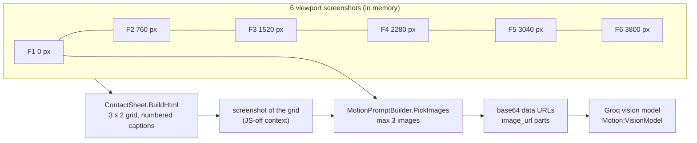

**How the images are read**: they are never saved to disk or the database. `PickImages` sends image 1 = the first
screen at full size, then the contact sheet(s), up to `Motion:MaxImagesPerRequest` (3). By default that is
**2 images** (first screen + one sheet). [GroqLlmClient.BuildBody](../../backend/ProjectMD.Api/Services/Ai/GroqLlmClient.cs)
turns the user message into parts: one text part (the measured facts) then one `image_url` part per image as
`data:image/jpeg;base64,...`. The vision model compares the numbered frames to spot motion. Each image is budgeted
at 2048 tokens.

---

## 7. Groq: where the prompts are

Every call goes through **one** method: `GroqLlmClient.CompleteAsync` sends
`POST https://api.groq.com/openai/v1/chat/completions` with `messages: [system, user]`, `temperature: 0`,
no streaming, and the API key only in the `Authorization` header. The **prompts are constants in C#**:

| # | Who builds it | System prompt lives in | User message (facts) | Model | Answer becomes |
| --- | --- | --- | --- | --- | --- |
| 1 | [PromptBuilder](../../backend/ProjectMD.Api/Services/Ai/PromptBuilder.cs) | `PromptBuilder.SystemPrompt` | between `<<<FACTS` and `FACTS>>>`: title, description, tech, rendering hints, API endpoints as ids E1..E15, design summary, outline, short text excerpt. Capped at `Ai:MaxInputTokens` (3000). | `Ai:FastModel` (`openai/gpt-oss-20b`) with strict JSON schema | `AiDocument`: overview, architecture, endpoint purposes, design, tips |
| 2 | [MotionPromptBuilder](../../backend/ProjectMD.Api/Services/Ai/MotionPromptBuilder.cs) | `MotionPromptBuilder.SystemPrompt` + `ShapeInstructions` | between `<<<VISUAL` and `VISUAL>>>`: libraries, measured animations and scroll triggers with real timings, colours, fonts, radii, shadows. **Plus the images.** | `Motion:VisionModel` (`qwen/qwen3.8-27b`), `json_object` | `MotionNotes`: summary, animations[], design breakdown |
| 3 | [ComponentAnalyzer](../../backend/ProjectMD.Api/Services/Ai/ComponentAnalyzer.cs) | `ComponentAnalyzer.SystemPrompt` + `ShapeInstructions` | between `<<<COMPONENTS` and `COMPONENTS>>>`: one line of measured CSS per component | `Ai:FastModel` | `ComponentPreviews`: up to 8 HTML + CSS snippets |

Never sent: raw HTML, scripts, the URL, or anything about you. That keeps answers cacheable across users and
stops page text from being treated as instructions (facts are flattened and fenced between markers).

Every call follows the same credit-saving loop:

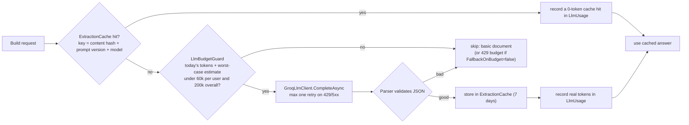

---

## 8. The database

PostgreSQL (Aiven), through EF Core ([AppDbContext.cs](../../backend/ProjectMD.Api/Data/AppDbContext.cs)). The
connection string comes from `backend/.env`. Firebase stores only your login; **everything else is here**.

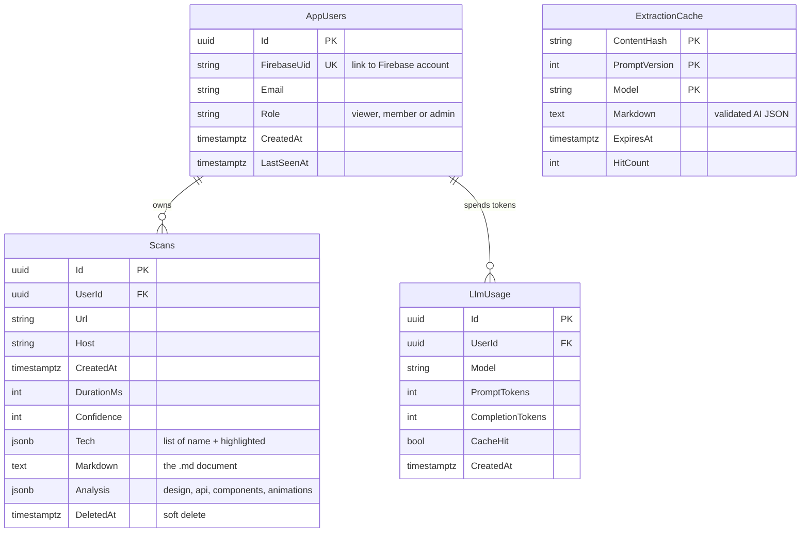

- **Clear history** is a soft delete: `DeletedAt` is set, a global filter hides the rows, but they still count
  toward the month (no "create, clear, repeat").
- **Screenshots are never stored.** `ExtractionCache` holds AI answers only, never page HTML.

---

## 9. RBAC (who may do what)

Three roles, five permissions. The same matrix exists twice: the backend **enforces**, the frontend only
**hides buttons**.

| Permission | viewer | member | admin |
| --- | :-: | :-: | :-: |
| `scan:read` (list and open your scans) | yes | yes | yes |
| `scan:export` (copy and download) | yes | yes | yes |
| `scan:create` (also needs a **verified email**) | - | yes | yes |
| `history:clear` | - | yes | yes |
| `admin:access` (`/admin/users`) | - | - | yes |

Backend: [Roles.cs](../../backend/ProjectMD.Api/Auth/Roles.cs), [Permissions.cs](../../backend/ProjectMD.Api/Auth/Permissions.cs),
[PermissionRules.cs](../../backend/ProjectMD.Api/Auth/PermissionRules.cs). Frontend mirror:
[rbac/roles.ts](../../frontend/app/functions/rbac/roles.ts), [rbac/permissions.ts](../../frontend/app/functions/rbac/permissions.ts),
[rbac/can.ts](../../frontend/app/functions/rbac/can.ts).

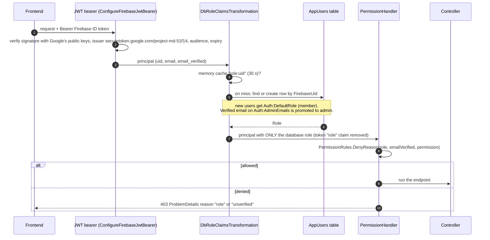

How the frontend learns your role (server mode):

1. Firebase says you are signed in, so `AuthProvider` calls `setMeOwner(uid)`
   ([data/me-store.ts](../../frontend/app/functions/data/me-store.ts)), which sends `GET /api/me`.
2. `/api/me` returns `{ uid, email, emailVerified, role, usage }`. The role comes from the database.
3. Until that answers, auth status stays `loading` and every `useCan()` is `false`. If it fails you become a
   `viewer` and `ServerNotice` offers Retry. It **fails closed**: an error never gives more access.
4. UI gates: `useCan("scan:create")`, `<Can permission="admin:access">`, `assertCan()` inside `startScan`.

Admins change roles at `/admin/users` (`PUT /api/admin/users/{id}/role`). The server evicts the 30 s role
cache so it applies on the very next request, refuses changing your own role (`self`) and removing the last
admin (`last-admin`).

---

## 10. Where the app remembers that you are logged in

**The backend remembers nothing between requests.** No cookies, no server sessions. Each request carries a
token and is checked from scratch.

| What | Where it lives | Survives a refresh? |
| --- | --- | --- |
| Firebase session (refresh token + ID token) | Browser **IndexedDB**, database `firebaseLocalStorageDb`, written by the Firebase SDK (default "local" persistence; the app never calls `setPersistence`) | **yes**, until you sign out |
| ID token (1 hour JWT) | Inside the Firebase SDK; refreshed automatically with the refresh token; `apiFetch` gets it with `getIdToken()` per request | renewed as needed |
| `CurrentUser` (uid, email, verified, role) | React state in `AuthProvider` ([AuthProvider.tsx](../../frontend/app/functions/auth/AuthProvider.tsx)) | rebuilt on load from `onAuthStateChanged` |
| Your role + usage | `me-store` memory, from `GET /api/me` | re-fetched on load |
| Scan history (server mode) | `history-store` memory, loaded from `GET /api/scans` | re-fetched on load |
| Scan history (static mode) | `localStorage` key `projectmd.history.<uid>` | yes |
| Role cache (backend) | `IMemoryCache` "role:uid", 30 seconds | server memory only |

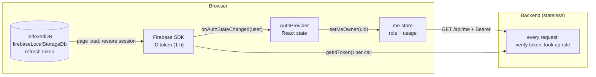

Want to see it? Open DevTools, Application tab, IndexedDB, `firebaseLocalStorageDb`, `firebaseLocalStorage`.

Route guards ([auth/guards.tsx](../../frontend/app/functions/auth/guards.tsx)): `RequireAuth` wraps the
workspace (signed out goes to `/login?next=...`), `RedirectIfAuthed` wraps the login screens. These are
convenience only; the backend is the lock.

---

## 11. How animations are broken down

Three layers: **measure** (browser facts), **see** (vision AI), **package** (code, no AI).

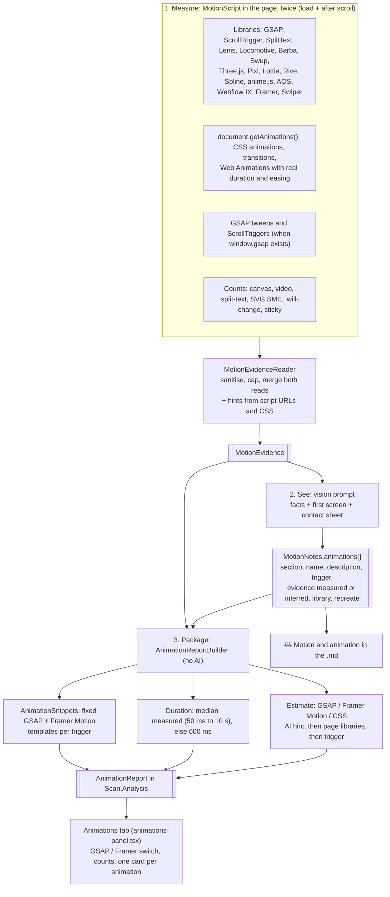

Trigger words: `load`, `scroll`, `scroll-scrub`, `hover`, `click`, `loop`, `page-transition`, `unknown`.
The snippets only take the trigger and a number, so no page or AI text can land inside the code. `.target` is
a placeholder for you to replace.

---

## 12. How components (and the design system) are broken down

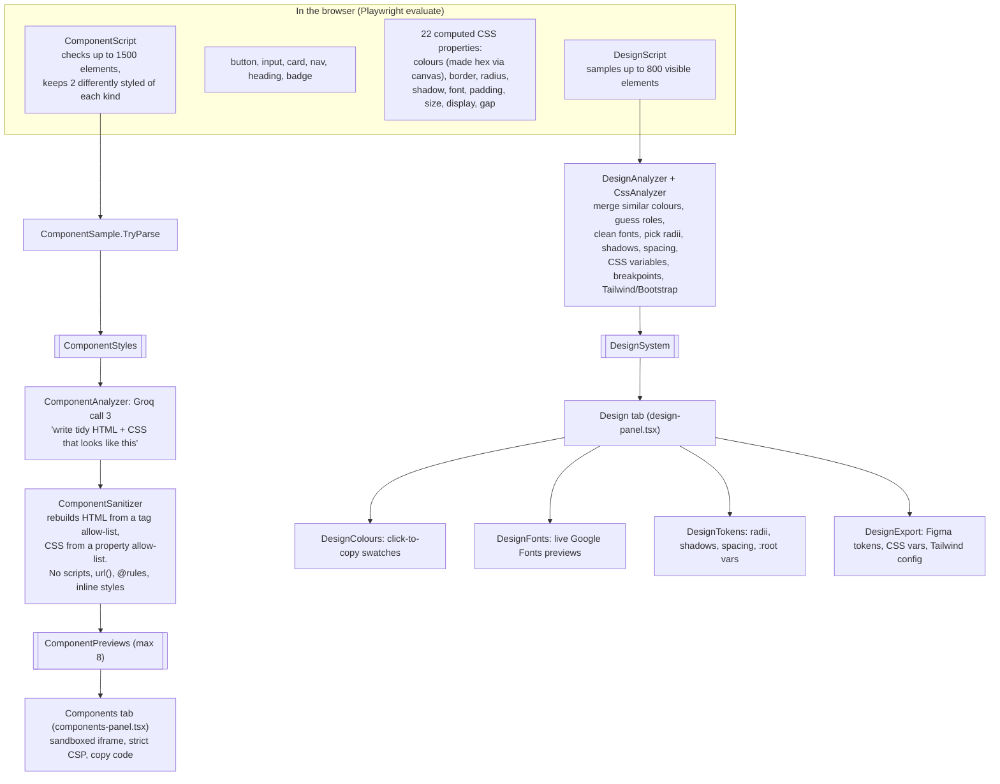

> [docs/HANDOFF.md](../HANDOFF.md) has unresolved merge-conflict markers, and one side says component previews
> no longer use AI. The code on this branch **does** still use AI (`ComponentAnalyzer`).

---

## 13. Frontend component tree

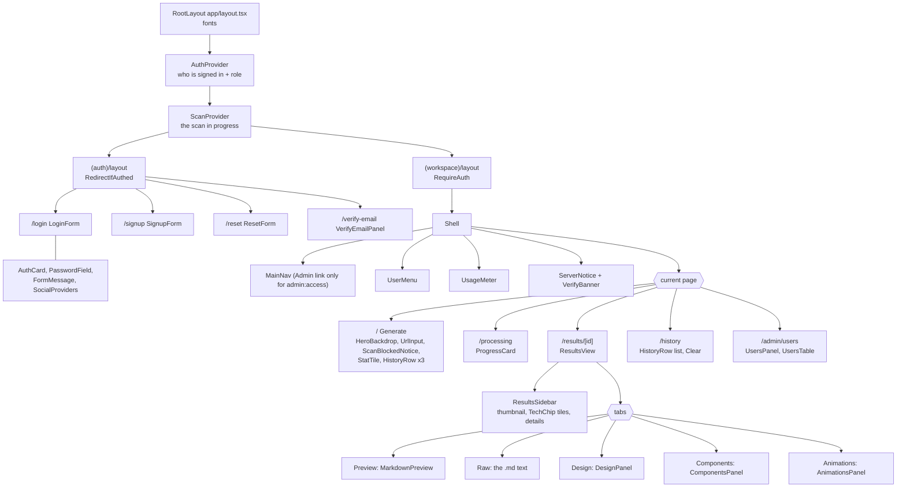

What the key pieces do:

| Component / function | Job |
| --- | --- |
| `AuthProvider` | Listens to Firebase, builds `CurrentUser`, merges the server role, exposes `useAuth()`. |
| `ScanProvider` (components/scan-provider.tsx) | Runs the progress timer, calls `scanProvider.generate`, saves to history, sets `scanId`. |
| `scanProvider` (data/scan-provider.ts) | The data source: `apiScanProvider` or `staticScanProvider`. |
| `apiFetch` | Adds the Bearer token, retries 401 once, turns errors into `ApiError` with a `reason`. |
| `apiErrorMessage` | Maps `unverified`, `role`, `quota`, rate, 400, offline to friendly text. |
| `me-store` / `usage-store` | One `GET /api/me` per sign-in feeds both the role and the usage meter. |
| `history-store` | The scan list; `useHistory()`, `addScan`, `clearHistory` (calls `DELETE /api/scans` in api mode). |
| `ResultsView` | Finds the scan by id, splits Markdown into Preview vs Design (`design-sections.ts`), renders tabs. Copy/Download need `scan:export`. |
| `MarkdownPreview` | Own tiny Markdown renderer. Never renders raw HTML, every piece is a React text node. |
| `useCopy` | Clipboard copy with a fallback and a live-region message. |
| `design-export.ts` | Pure functions: Tokens Studio JSON, CSS variables, Tailwind config, with value checks. |

---

## 14. Endpoints at a glance

| Method + path | Policy | Does |
| --- | --- | --- |
| `GET /api/health` | anonymous | health check |
| `GET /api/me` | signed in | creates/refreshes your row, returns role + usage |
| `GET /api/scans` | `scan:read` | your scans, newest first |
| `GET /api/scans/{id}` | `scan:read` | one of yours (someone else's is a 404) |
| `POST /api/scans` | `scan:create` + rate limit | run the whole pipeline, save, return 201 |
| `DELETE /api/scans` | `history:clear` | soft delete all yours |
| `GET /api/admin/users` | `admin:access` | up to 200 users |
| `PUT /api/admin/users/{id}/role` | `admin:access` | change a role |

Swagger is at http://localhost:5080/swagger in Development.

---

## 15. Things I noticed while reading

1. `appsettings.json` has `Scanner:Mode = "static"`, the backend **mock**. Real scans need `Scanner__Mode=ai`
   in `backend/.env`.
2. The Processing screen's steps are a fixed 3 s animation and the real request only starts after it, so every
   scan takes about 3 s longer than it needs to.
3. `frontend/lib/scrape.ts` + `test-scrape.ts` are unused, need a `playwright` package that is not installed, and
   have no private-IP guard (`// TODO: block localhost`). Delete them or keep them out of the app.
4. `docs/HANDOFF.md` has unresolved `<<<<<<< HEAD` merge markers.
5. `docs/ARCHITECTURE.md` describes the old browser-only mock and should be replaced by or point to this file.
6. The Results sidebar thumbnail is an illustration, not a real screenshot (screenshots are never stored).
